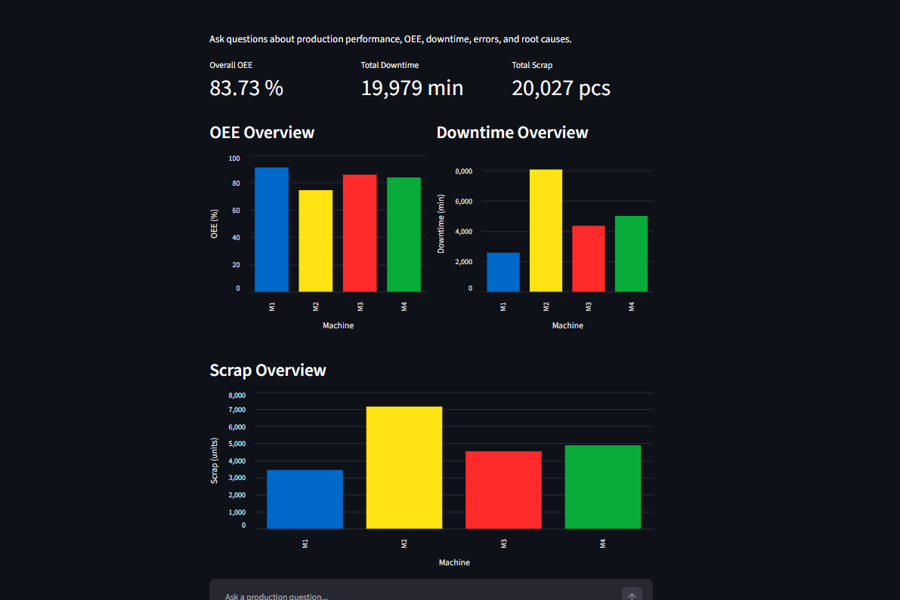
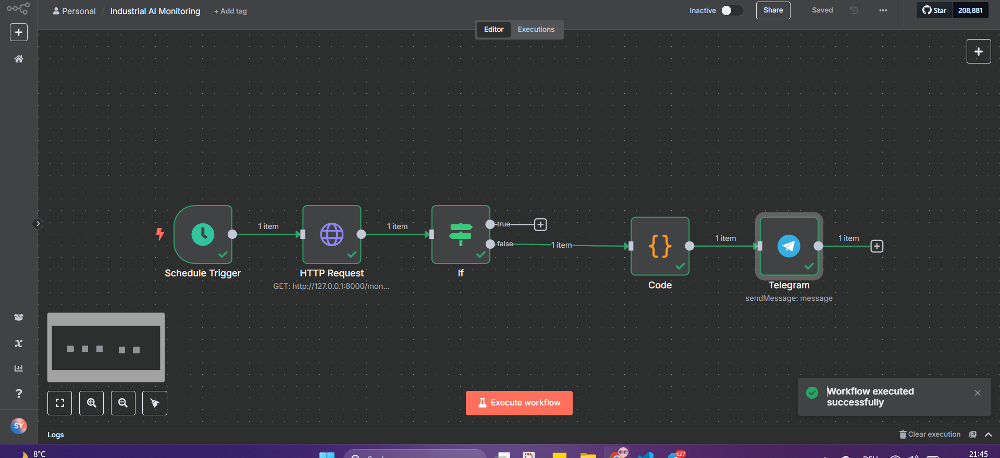
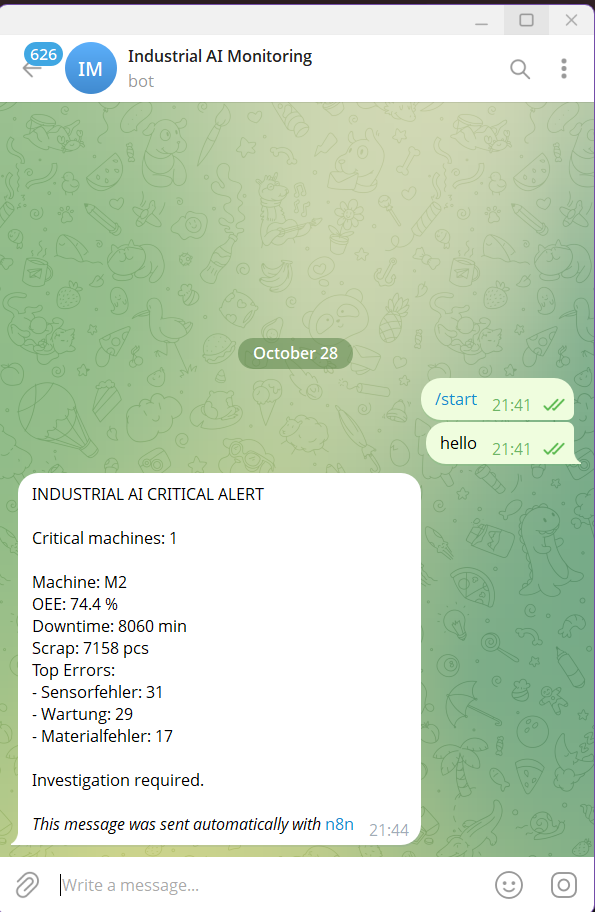
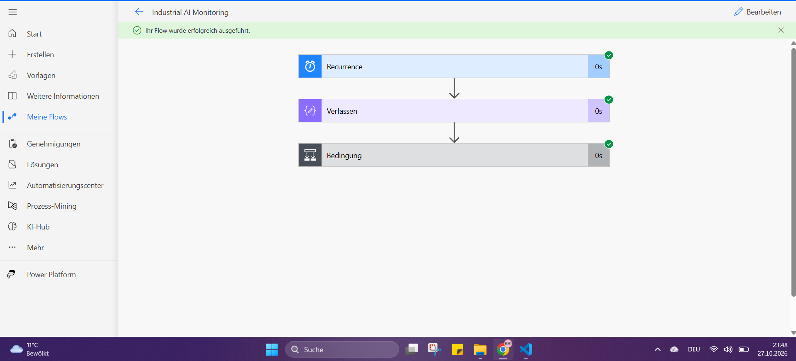
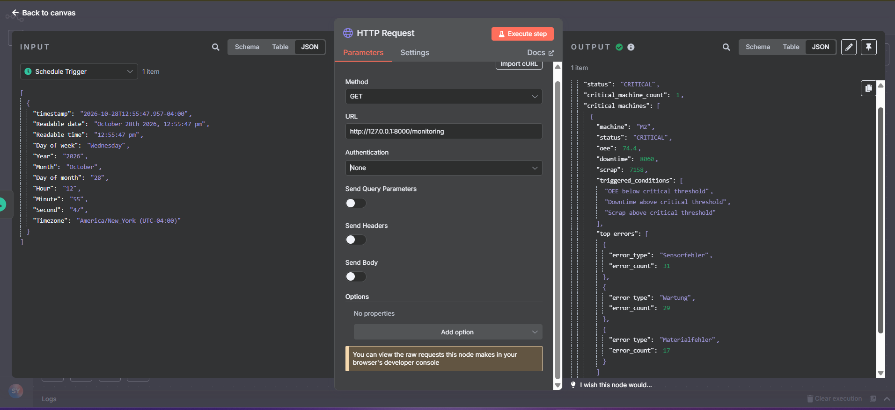

# Industrial AI Analysis & Monitoring System

An industrial decision-support system combining production analytics, an interactive BI dashboard, conversational AI, proactive monitoring, REST API integration, and workflow automation.

The project demonstrates how production data can be used in two complementary ways:

**Reactive decision support:**  
A user opens the dashboard, explores production KPIs, and asks questions through a conversational AI assistant.

**Proactive monitoring:**  
The system periodically checks production data automatically and sends an alert when critical production conditions are detected.

---

# Project Evolution

This project was developed incrementally.

## Phase 1 — Intelligent Production Dashboard

The first version focused on production analytics and visualization.

Production data was processed and stored in SQLite and displayed in a Streamlit dashboard.

The dashboard provides information such as:

- Overall Equipment Effectiveness (OEE)
- Downtime
- Scrap quantity
- Production errors
- Machine comparison
- Machine-specific KPIs

The user can visually inspect production performance without directly querying the database.

---

## Phase 2 — Conversational AI Assistant

The dashboard was extended with a local AI assistant.

The user can now ask natural-language questions such as:

```text
Which machine has the lowest OEE?

Which machine has the highest downtime?

How is machine M2 performing?

Which machine should be investigated first?

What are the most frequent production errors?
```

The system combines:

```text
User Question
      ↓
LangChain Agent
      ↓
Python Analytics Tools
      ↓
SQLite Production Database
      ↓
Llama 3.1 via Ollama
      ↓
Response Guard
      ↓
Final Answer
```

The LLM does not calculate production KPIs itself.

Measured values are retrieved through deterministic Python and SQL analytics functions.

The language model is primarily responsible for natural-language interaction and explanation.

---

# Phase 3 — Proactive Production Monitoring

The next extension addressed an important limitation of a normal dashboard:

A dashboard normally requires a user to open it and actively inspect the data.

The monitoring component allows the system to check production conditions automatically without waiting for a user question.

Current monitoring logic evaluates:

```text
OEE
Downtime
Scrap
Machine-specific errors
```

Prototype thresholds are currently used:

```text
OEE < 80 %

Downtime > 6000 minutes

Scrap > 6000 pieces
```

A machine is classified as `CRITICAL` when at least two monitoring conditions are triggered.

These values are prototype thresholds for the current dataset and are not presented as universal industrial standards.

In a real production environment, they would be replaced by process-specific limits, production targets, engineering specifications, or company-defined thresholds.

---

# Monitoring Output

The Python monitoring module generates structured data such as:

```json
{
  "status": "CRITICAL",
  "critical_machine_count": 1,
  "critical_machines": [
    {
      "machine": "M2",
      "status": "CRITICAL",
      "oee": 74.4,
      "downtime": 8060,
      "scrap": 7158,
      "triggered_conditions": [
        "OEE below critical threshold",
        "Downtime above critical threshold",
        "Scrap above critical threshold"
      ],
      "top_errors": [
        {
          "error_type": "Sensorfehler",
          "error_count": 31
        },
        {
          "error_type": "Wartung",
          "error_count": 29
        },
        {
          "error_type": "Materialfehler",
          "error_count": 17
        }
      ]
    }
  ]
}
```

The monitoring result can also be written to:

```text
data/monitoring_output.json
```

The generated runtime file is excluded from Git.

---

# FastAPI Monitoring Interface

To connect the Python monitoring system with external automation tools, a REST API was added using FastAPI.

The monitoring endpoint is:

```text
GET /monitoring
```

Local example:

```text
http://127.0.0.1:8000/monitoring
```

The API executes the monitoring logic and returns the current production status as structured JSON.

Architecture:

```text
SQLite Production Database
          ↓
Python Analytics
          ↓
Monitoring Rules
          ↓
FastAPI
          ↓
REST / JSON
```

This separates the analytics layer from external workflow automation.

---

# Phase 4 — Microsoft Power Automate Prototype

Microsoft Power Automate was initially evaluated as the workflow automation layer.

A scheduled cloud flow was created with:

```text
Recurrence
     ↓
Monitoring Payload
     ↓
Condition
     ↓
Critical?
     ↓
Alert Payload
```

The workflow logic and conditional execution were successfully tested.

However, external notification delivery through Microsoft Teams, Outlook, Gmail, and Mail connectors could not be completed in the available Microsoft environment because of tenant, authentication, or connector restrictions.

Therefore, the Power Automate implementation is presented as a successfully tested **automation prototype**, not as a deployed notification system.

This limitation motivated the implementation of the same monitoring use case with n8n.

---

# Phase 5 — n8n Automated Monitoring

The monitoring workflow was then implemented with n8n.

Unlike the Power Automate prototype, the n8n workflow is connected directly to the real Python monitoring API.

Current workflow:

```text
Schedule Trigger
        ↓
HTTP Request
        ↓
FastAPI /monitoring
        ↓
IF critical_machine_count == 0
      ↙                       ↘
   TRUE                       FALSE
No critical               Critical machine
machine                        ↓
                          Code Node
                              ↓
                     Build Alert Message
                              ↓
                          Telegram
                              ↓
                       Real Alert
```

The workflow can be configured to execute automatically at a defined interval.

For example:

```text
Every 1 hour
Every 6 hours
Every 8 hours
Every 12 hours
Every 24 hours
```

If no machine is critical, the workflow performs no notification action.

If one or more machines are critical, the workflow dynamically creates an alert containing the information for the affected machines.

---

# Real Telegram Alert

The n8n workflow successfully sends real Telegram notifications.

Example alert:

```text
INDUSTRIAL AI CRITICAL ALERT

Critical machines: 1

Machine: M2
OEE: 74.4 %
Downtime: 8060 min
Scrap: 7158 pcs

Top Errors:
- Sensorfehler: 31
- Wartung: 29
- Materialfehler: 17

Investigation required.
```

The alert is generated dynamically from the monitoring API.

Machine IDs and KPI values are not hard-coded into the Telegram notification.

If multiple machines become critical, the workflow can include information for all critical machines in the generated alert.

---

# Complete Current Architecture

The current project combines interactive analytics and proactive monitoring.

```text
                       PRODUCTION DATA
                              │
                              ▼
                     SQLite Database
                              │
             ┌────────────────┴────────────────┐
             │                                 │
             ▼                                 ▼
      Streamlit Dashboard               Python Monitoring
             │                                 │
             │                                 ▼
             │                         Critical Detection
             │                                 │
             ▼                                 ▼
       AI Assistant                         FastAPI
             │                                 │
             │                                 ▼
       User Questions                         n8n
                                               │
                                               ▼
                                      Scheduled Workflow
                                               │
                                               ▼
                                      Telegram Alert
```

The two sides serve different purposes.

The dashboard and conversational assistant support interactive analysis.

The monitoring workflow operates automatically and does not require the user to open the dashboard or ask a question.

---


# Screenshots

## Streamlit Production Dashboard

The Streamlit interface combines production KPI visualization with the conversational AI assistant.



---

## n8n End-to-End Monitoring Workflow

The n8n workflow retrieves the real monitoring status from the FastAPI endpoint, evaluates whether critical machines exist, builds a dynamic alert message, and sends the result through Telegram.



---

## Real Telegram Critical Alert

When one or more machines are classified as critical, the workflow sends a real Telegram notification containing the affected machine, KPI values, and frequent errors.



---

## Microsoft Power Automate Prototype

Before implementing the final n8n workflow, Microsoft Power Automate was evaluated for scheduled monitoring and conditional alert generation.

The workflow logic was successfully tested, while external notification delivery through Microsoft Teams, Outlook, Gmail, and Mail connectors was limited by the available Microsoft tenant environment.



---

## FastAPI Monitoring Response in n8n

The n8n HTTP Request node retrieves structured monitoring data directly from the Python FastAPI service.



---


# Streamlit Dashboard

The Streamlit application provides:

- Overall OEE
- Total downtime
- Total scrap
- OEE by machine
- Downtime by machine
- Scrap by machine
- Error frequency visualization
- Dynamic machine KPI cards
- Interactive AI chat
- Machine comparison
- Production problem investigation

The dashboard and AI assistant use the same production data.

The AI assistant does not inspect chart pixels.

Both components access the underlying production data and analytics functions.

---

# Production Problem Investigation

The project identifies machines that should be investigated based on measured KPI evidence.

For the current dataset, M2 has:

```text
OEE: 74.4 %
Downtime: 8060 minutes
Scrap: 7158 pieces
```

Within the current data:

```text
M2 has the lowest average OEE.
M2 has the highest accumulated downtime.
M2 has the highest accumulated scrap quantity.
```

Its most frequent recorded errors include:

```text
Sensorfehler: 31
Wartung: 29
Materialfehler: 17
```

These errors are treated as investigation indicators.

The system does not claim that error frequency alone proves a causal relationship with OEE, downtime, or scrap.

---

# Response Guard

Local LLMs may occasionally return incomplete answers or remove important numerical evidence.

The project therefore includes a deterministic Response Guard.

Simplified process:

```text
Production Analysis
        ↓
LLM Response
        ↓
Response Guard
        ↓
Final User Answer
```

The guard helps ensure that:

- production KPI evidence is preserved
- important numerical values remain in the answer
- internal implementation names are not unnecessarily exposed
- incomplete LLM summaries can fall back to deterministic analysis output

---

# Current Data Source

The current project uses a static production dataset stored in SQLite.

This makes the project reproducible and suitable for local development and portfolio demonstration.

The monitoring architecture itself is designed so the data source can later be replaced without redesigning the complete system.

---

# Future Real-Time Industrial Architecture

In a real industrial environment, production data could come directly from machines and sensors.

Possible data sources include:

```text
PLC
Industrial sensors
Machine controllers
MES
SCADA
IoT devices
REST APIs
OPC UA
MQTT
Cloud databases
Time-series databases
```

A possible production architecture would be:

```text
Machines / PLC / Sensors
          ↓
 OPC UA / MQTT / API
          ↓
 Real-Time Production Data
          ↓
   Analytics Platform
      ↙           ↘
Dashboard       Monitoring
   ↓                ↓
AI Assistant      Rules
   ↓                ↓
User Questions    n8n
                    ↓
             Alert / Notification
```

The monitoring workflow could run automatically every few hours or at much shorter intervals depending on production requirements.

This means a future user could simultaneously:

```text
1. Open the production dashboard and visually inspect current KPIs.

2. Ask the language model questions about machines and production performance.

3. Receive automatic alerts without opening the dashboard when the monitoring system detects critical production conditions.
```

This combination of reactive AI interaction and proactive monitoring is one of the main architectural goals of the project.

---

# Technology Stack

## Data & Analytics

```text
Python 3.11
Pandas
SQLite
```

## Dashboard

```text
Streamlit
Altair
```

## Artificial Intelligence

```text
LangChain
Ollama
Llama 3.1
```

## API

```text
FastAPI
Uvicorn
REST / JSON
```

## Workflow Automation

```text
Microsoft Power Automate
n8n
```

## Notifications

```text
Telegram Bot
```

## Development

```text
Visual Studio Code
Git
GitHub
```

---

# Project Structure

Simplified project structure:

```text
industrial-ai-analysis-system/
│
├── app/
│   ├── agent/
│   │   ├── llm_agent.py
│   │   ├── response_formatter.py
│   │   └── tools.py
│   │
│   ├── analytics/
│   │   └── production_analysis.py
│   │
│   ├── insights/
│   │   ├── report_generator.py
│   │   └── root_cause_analysis.py
│   │
│   ├── interface/
│   │   └── main.py
│   │
│   ├── pipeline/
│   │   ├── extract.py
│   │   ├── transform.py
│   │   ├── validate.py
│   │   └── load.py
│   │
│   ├── api.py
│   ├── monitoring.py
│   └── run_pipeline.py
│
├── database/
│   ├── production_analysis.db
│   └── production_clean.db
│
├── docs/
│   └── screenshots/
│       ├── 01_dashboard_overview.png
│       ├── 02_n8n_end_to_end_workflow.png
│       ├── 03_telegram_critical_alert.png
│       ├── 04_power_automate_prototype.png
│       └── 05_n8n_fastapi_response.png
│
├── README.md
├── requirements.txt
└── .gitignore
```

Additional development and test scripts may be present in the repository.

---

# Installation

Clone the repository:

```bash
git clone https://github.com/samanyousefi-Projekte/industrial-ai-analysis-system.git
cd industrial-ai-analysis-system
```

Create a virtual environment.

Windows:

```powershell
python -m venv .venv
.venv\Scripts\Activate.ps1
```

Install dependencies:

```bash
pip install -r requirements.txt
```

---

# Ollama Setup

Download the local language model:

```bash
ollama pull llama3.1
```

Test Ollama:

```bash
ollama run llama3.1
```

---

# Run Data Pipeline

```bash
python -m app.run_pipeline
```

---

# Run Streamlit Dashboard and AI Assistant

```bash
streamlit run app/interface/main.py
```

---

# Run Monitoring Manually

```bash
python -m app.monitoring
```

---

# Run Monitoring API

```bash
uvicorn app.api:app --reload
```

Monitoring endpoint:

```text
http://127.0.0.1:8000/monitoring
```

---

# Run n8n Locally

Example:

```bash
npx n8n
```

The workflow connects to the FastAPI monitoring endpoint and processes the returned JSON.

For scheduled local execution, both n8n and the FastAPI service must remain available.

A production deployment would normally run these components as persistent services, containers, or cloud workloads.

---

# Reliability Principles

The project follows several principles:

- KPI calculations are based on production data, not LLM guesses.
- Critical monitoring decisions are made by deterministic rules.
- The LLM is used mainly for interaction and explanation.
- Error frequency is not treated as proof of causality.
- Monitoring thresholds are explicitly identified as prototype values.
- Alert content is created dynamically from monitoring data.
- The dashboard and monitoring workflow use the same underlying production information.
- External automation is separated from analytics through a REST API.

---

# Current Implementation Status

Successfully implemented and tested:

```text
Production data pipeline
SQLite production database
Production KPI analytics
OEE analysis
Downtime analysis
Scrap analysis
Global error analysis
Machine-specific error analysis
Machine performance analysis
Production problem investigation
Streamlit dashboard
Interactive AI chat
LangChain agent
Local Llama 3.1 through Ollama
Response Guard
Rule-based proactive monitoring
Critical machine detection
Structured JSON monitoring output
FastAPI monitoring endpoint
Power Automate scheduled workflow prototype
n8n scheduled monitoring workflow
n8n HTTP integration with FastAPI
Dynamic alert generation
Telegram Bot integration
Successful end-to-end Telegram alert
```

Current limitations:

```text
Current production data is static rather than live sensor data.

Power Automate external email/Teams notification could not be completed because of environment-specific connector restrictions.

Current n8n/FastAPI deployment is local and requires the services to be running.
```

---

# Possible Future Extensions

```text
Real-time PLC integration
OPC UA
MQTT
Sensor streaming
MES integration
SCADA integration
Historical alert database
Predictive maintenance
Time-series anomaly detection
RAG with maintenance documentation
Knowledge Graph
GraphRAG
Power BI integration
Docker deployment
Cloud deployment
Enterprise Teams / Email alerts
Authentication and API security
Monitoring dashboard for workflow executions
```

---

# Project Purpose

The project demonstrates an evolution from a traditional production dashboard toward a broader Industrial AI decision-support system.

It combines:

```text
Data Engineering
Production Analytics
Business Intelligence
Generative AI
REST APIs
Rule-Based Monitoring
Workflow Automation
Automated Notifications
```

The final architecture supports both human-driven analysis and automatic monitoring.

A production user can inspect the dashboard and interact with the AI assistant while the automation layer independently monitors production conditions and sends alerts when intervention may be required.